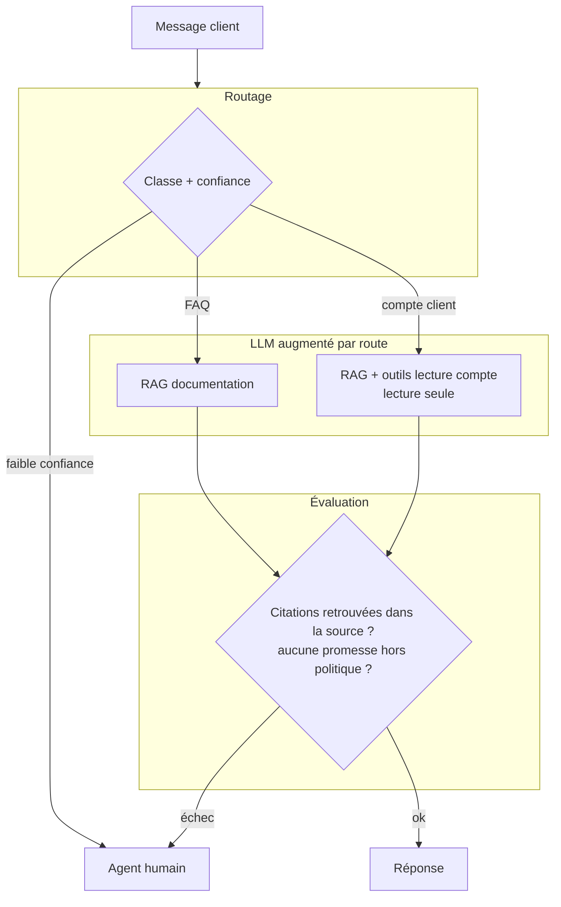
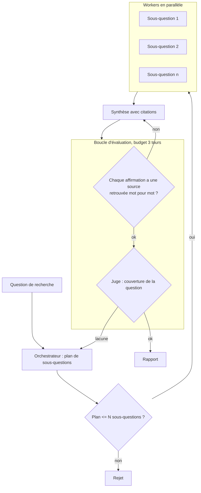
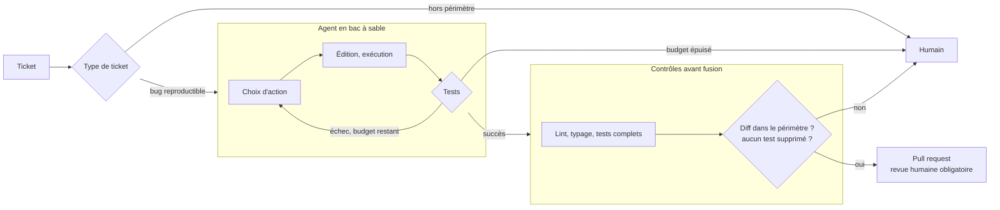

# Combinaisons de production

En production, on compose les patterns. Chaque jonction est un nouveau point de panne : c'est là que les schémas simples ne montrent rien. Les trois architectures ci-dessous sont des **exemples de conception**, pas des retours d'expérience chiffrés.

## A. Support client : routage → LLM augmenté → évaluateur

| Jonction | Mode de panne | Parade |
|---|---|---|
| Routage → route | Mauvaise route, donc mauvais outils | Seuil de confiance ; les droits dépendent de la route |
| Outil compte → LLM | Injection dans un champ client (nom, note) | Données d'outil délimitées, outils en lecture seule |
| LLM → évaluation | Réponse plausible sans source | Correspondance exacte des citations, sinon humain |
| Global | Taux d'escalade qui dérive | Suivi hebdomadaire par route |

## B. Recherche multi-sources : orchestrateur → parallélisation → évaluateur-optimiseur

| Jonction | Mode de panne | Parade |
|---|---|---|
| Orchestrateur | Sous-questions redondantes, coût multiplié | Plafond, dédoublonnage des sous-questions |
| Workers → synthèse | Fausse corroboration : deux sources reprennent la même origine | Compter les origines, pas les URL |
| Synthèse | Affirmation sans source, lissée par le style | Contrôle déterministe des citations |
| Boucle vers l'orchestrateur | Replanification sans fin | Budget global de tours et de tokens, partagé par toute la chaîne |

## C. Agent de code : routage → agent → contrôles déterministes → humain

| Jonction | Mode de panne | Parade |
|---|---|---|
| Agent → tests | L'agent « répare » en modifiant ou supprimant le test | Contrôle du diff : tests existants inchangés |
| Agent | Boucle sur le même échec | Détection de répétition, budget de tours |
| Bac à sable | Accès réseau ou secrets | Environnement isolé, sans secrets de production |
| Fusion | Merge automatique d'un correctif plausible mais faux | Revue humaine obligatoire, jamais de fusion par l'agent |

## Règle de composition
Un **budget unique** (tokens, temps, tours) pour toute la chaîne, pas un par composant : sinon les boucles imbriquées multiplient les plafonds entre eux.
