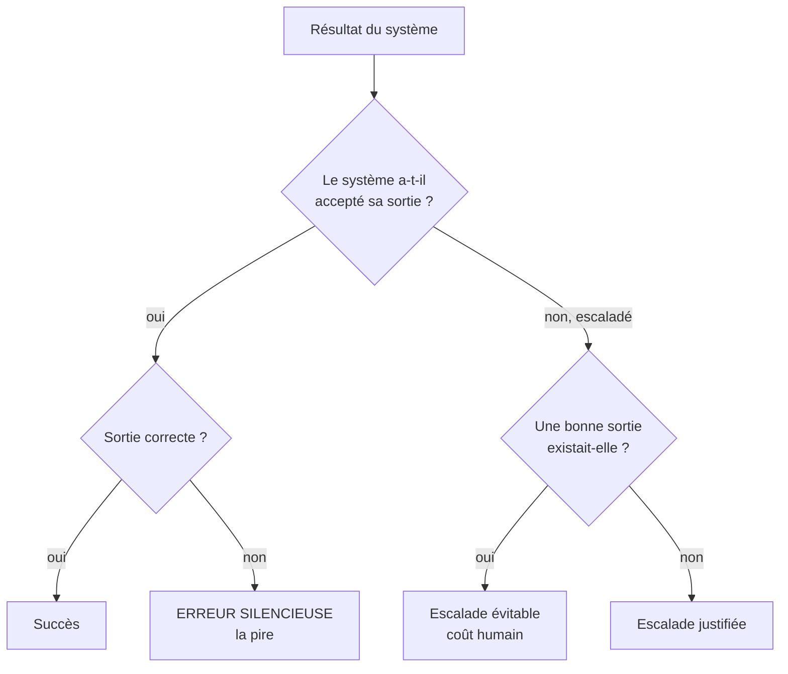

# Évaluation

Sans mesure, on ne sait pas si un pattern plus complexe apporte quelque chose. Ce fichier décrit **comment** mesurer. Il ne donne aucun chiffre de référence : ceux-ci dépendent de vos données.

## 1. Le jeu d'évaluation figé
- Des entrées réelles anonymisées ou synthétiques réalistes, avec la sortie attendue (vérité terrain).
- Inclure les cas difficiles : ambigus, hors périmètre, contradictoires, tentatives d'injection.
- **Versionné dans le dépôt** et jamais modifié pour faire passer un modèle. On ajoute des cas, on n'en retire pas.
- Taille : assez pour que l'écart entre deux variantes dépasse le bruit. Rejouer plusieurs fois si le système est non déterministe.

## 2. Classer chaque résultat

## 3. Métriques

| Métrique | Définition | Pourquoi |
|---|---|---|
| Erreurs silencieuses | Sorties acceptées mais fausses / total | Ce que personne ne verra. À minimiser avant tout. |
| Taux de succès | Sorties acceptées et correctes / total | Utilité réelle |
| Taux d'escalade | Tâches renvoyées à un humain / total | Coût humain caché |
| Coût par tâche | Tokens + appels outils, en distribution (médiane, p95, max) | La moyenne cache les tâches qui explosent |
| Latence par tâche | Idem, en distribution | Même raison |
| Itérations / tours | Pour les boucles et agents | Détecte la dérive et les plafonds atteints |

## 4. Protocole de comparaison
1. Mesurer d'abord la variante la plus simple (un appel, ou le workflow codé).
2. Mesurer la variante complexe **sur le même jeu**.
3. Ne garder la complexité que si elle réduit les erreurs silencieuses ou augmente le succès au-delà du bruit, pour un coût acceptable.

## 5. En production
- Échantillonner des sorties acceptées pour revue humaine : c'est la seule façon de voir les erreurs silencieuses.
- Tout incident devient un nouveau cas du jeu figé.
- Alerter sur les variations : taux d'escalade, coût p95, distribution des routes.

## Exemple exécutable
`python3 examples/evaluateur_optimiseur.py` calcule ces métriques sur un jeu **synthétique** et compare une génération unique à la boucle avec garde-fous. Les chiffres obtenus décrivent ce jeu jouet et un LLM simulé, rien d'autre.
