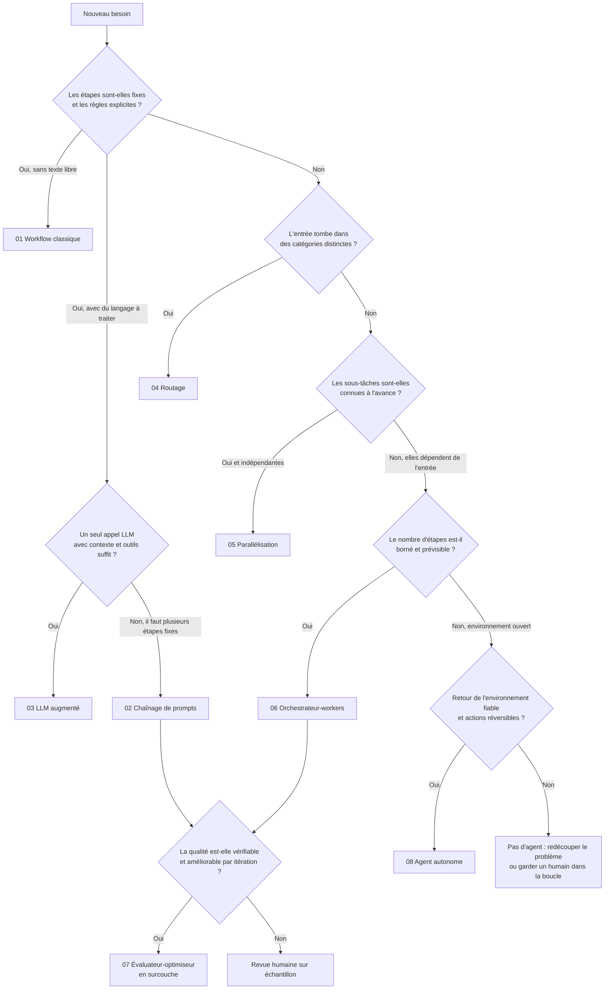

# Patterns agentiques : le guide de décision

Neuf patterns, de l'automatisation classique à l'agent autonome. Les listes de patterns, il y en a partout. Ce dépôt répond à la question qui compte en production : **lequel choisir, ce qu'il coûte, comment il casse et comment le mesurer.**

Règle n°1 : **commencer par le plus simple qui passe le jeu d'évaluation.** Chaque marche vers plus d'autonomie se paie en coût, en latence et en surface de panne. On ne la monte que si une mesure le justifie.

## Arbre de décision



Lecture : on descend tant que la réponse est non. La première feuille atteinte est le pattern le plus simple qui convient. Le fichier [09](patterns/09-frontiere-workflow-agent.md) sert de test de fin : si vous êtes arrivé à « agent », vérifiez que vous ne pouvez pas redescendre.

## Tableau comparatif

Coût et latence sont relatifs et qualitatifs (par rapport à un appel LLM unique). Aucun chiffre ici ne vient d'une mesure : mesurez les vôtres avec [EVALUATION.md](EVALUATION.md).

| # | Pattern | Quand l'utiliser | Coût | Latence | Risque principal |
|---|---|---|---|---|---|
| 01 | [Workflow classique](patterns/01-workflow-classique.md) | Règles explicites, données structurées | Quasi nul | Minimale | Rigidité face aux cas imprévus |
| 02 | [Chaînage de prompts](patterns/02-chainage-de-prompts.md) | Tâche découpable en étapes fixes | Faible à moyen | Moyenne (séquentielle) | Erreur en cascade d'une étape à l'autre |
| 03 | [LLM augmenté](patterns/03-llm-augmente.md) | Un appel avec recherche, outils, mémoire | Faible | Faible | Contexte faux ou injecté via un outil |
| 04 | [Routage](patterns/04-routage.md) | Entrées hétérogènes, catégories nettes | Faible | Faible | Mauvais aiguillage silencieux |
| 05 | [Parallélisation](patterns/05-parallelisation.md) | Sous-tâches indépendantes ou besoin de vote | Moyen à élevé | Faible (parallèle) | Fausse confiance par vote corrélé |
| 06 | [Orchestrateur-workers](patterns/06-orchestrateur-workers.md) | Sous-tâches imprévisibles mais bornées | Élevé | Élevée | Plan incomplet, synthèse qui masque les trous |
| 07 | [Évaluateur-optimiseur](patterns/07-evaluateur-optimiseur.md) | Critères clairs, itération utile | Moyen à élevé | Élevée (boucle) | Boucle infinie, juge complaisant |
| 08 | [Agent autonome](patterns/08-agent-autonome.md) | Problème ouvert, nombre d'étapes inconnu | Élevé et variable | Élevée et variable | Dérive des coûts, actions irréversibles |
| 09 | [Frontière workflow / agent](patterns/09-frontiere-workflow-agent.md) | Avant de choisir 06 ou 08 | — | — | Sur-ingénierie |

## Ce que ce guide ajoute aux schémas habituels

- **Un arbre de décision** au lieu d'une liste.
- **Pour chaque pattern** : quand ne pas l'utiliser, pannes typiques et parades, où mettre un contrôle déterministe au lieu d'un LLM juge, comment l'évaluer.
- **[COMBINAISONS.md](COMBINAISONS.md)** : en production on compose. Trois architectures réalistes et leurs modes de panne.
- **[EVALUATION.md](EVALUATION.md)** : jeu figé, erreurs silencieuses, coût par tâche, taux d'escalade.
- **[LIMITES.md](LIMITES.md)** : ce que ce guide ne promet pas.
- **[examples/](examples/)** : un évaluateur-optimiseur exécutable en Python pur, avec budget d'itérations, contrôle déterministe et arrêt propre.

## Principe transversal : déterministe d'abord

Un LLM qui juge un autre LLM partage souvent ses angles morts. Partout où une règle peut trancher (schéma JSON, arithmétique, regex, existence d'un identifiant, tests, citation retrouvée mot pour mot dans la source), la règle passe **avant** le juge LLM. Le juge ne sert qu'à ce qu'aucune règle ne sait vérifier.

## Source

Les patterns eux-mêmes sont des concepts connus. Leur taxonomie suit l'article d'Anthropic [« Building effective agents »](https://www.anthropic.com/engineering/building-effective-agents) (Erik S. et Barry Zhang, 19 décembre 2024), notamment la distinction workflows / agents et la recommandation de commencer simple. Les arbres, tableaux, analyses de pannes, combinaisons et l'exemple de code sont originaux.

## Lancer l'exemple

```bash
python3 examples/evaluateur_optimiseur.py
```

Python 3.8+, aucune dépendance.
