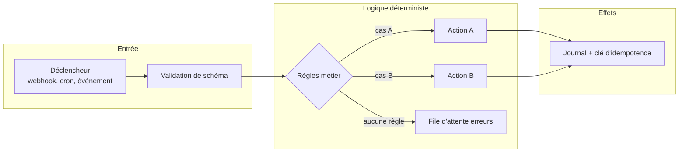

# 01 — Workflow classique (sans LLM)

Le point de départ, et souvent le point d'arrivée. Déclencheur, règles explicites, actions. Aucun modèle.

**Exemple (illustratif) :** une commande e-commerce payée déclenche création de facture, mise à jour du stock et e-mail de confirmation.

## Quand ne PAS l'utiliser
- Quand l'entrée est du texte libre, des images ou des documents hétérogènes.
- Quand le nombre de règles explose pour couvrir les variantes de formulation.

## Coût et latence
Coût quasi nul par exécution, latence minimale, comportement reproductible à l'identique.

## Pannes typiques et parades

| Panne | Symptôme | Détection | Parade |
|---|---|---|---|
| Cas non prévu | Entrée qui ne correspond à aucune règle | Branche « aucune règle » non vide | File d'erreurs + alerte, jamais d'action par défaut |
| Double exécution | Webhook relivré, relance après timeout | Clé d'idempotence déjà vue | Contrainte d'unicité côté base avant l'effet de bord |
| Schéma amont modifié | Champ renommé, valeur nulle | Validation de schéma en entrée | Rejet explicite plutôt que propagation |

## Contrôles déterministes
Tout est déterministe : c'est le niveau de référence auquel comparer les patterns suivants.

## Évaluation
Tests unitaires par règle, plus un jeu de cas limites figés (entrées vides, doublons, valeurs hors bornes). Métrique : taux d'entrées en file d'erreurs.
