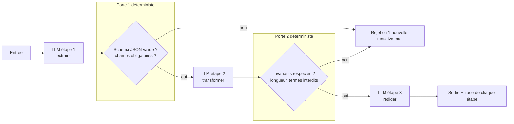

# 02 — Workflow IA : chaînage de prompts

Une suite **fixe** d'appels LLM, chaque appel traitant la sortie du précédent, avec des portes de contrôle entre les étapes.

**Exemple (illustratif) :** compte rendu d'appel → extraction des engagements → génération des tâches CRM → e-mail récapitulatif.

## Quand ne PAS l'utiliser
- Si un seul appel bien construit (pattern 03) passe déjà le jeu d'évaluation : chaque étape ajoute latence et un point de panne.
- Si l'ordre des étapes dépend de l'entrée : c'est du routage (04) ou de l'orchestration (06).

## Coût et latence
Coût proportionnel au nombre d'étapes. Latence additive, car séquentielle. Le gain attendu : chaque appel fait une tâche plus simple, donc plus fiable.

## Pannes typiques et parades

| Panne | Symptôme | Détection | Parade |
|---|---|---|---|
| Erreur en cascade | Étape 1 fausse mais plausible, la suite la polit | Porte déterministe après l'étape 1 | Valider le format et les invariants à chaque porte, pas seulement à la fin |
| Perte d'information | Un champ disparaît entre deux étapes | Comparaison des champs clés entrée/sortie | Passer l'entrée originale aux étapes suivantes, pas seulement la sortie précédente |
| Retry en boucle | La même porte échoue indéfiniment | Compteur de tentatives | Une tentative max, puis rejet vers revue humaine |
| Dérive de format | Le modèle change de structure après mise à jour | Taux d'échec de porte qui monte | Sorties structurées imposées + alerte sur le taux |

## Contrôles déterministes plutôt qu'un LLM juge
Schéma JSON, présence de champs, longueurs, liste de termes interdits, cohérence numérique entre étapes. Un LLM juge n'est justifié que pour un critère sémantique non vérifiable par règle.

## Évaluation
Jeu figé d'entrées avec la sortie attendue **par étape**. Mesurer le taux d'erreur par étape pour savoir laquelle casse, pas seulement le résultat final.
