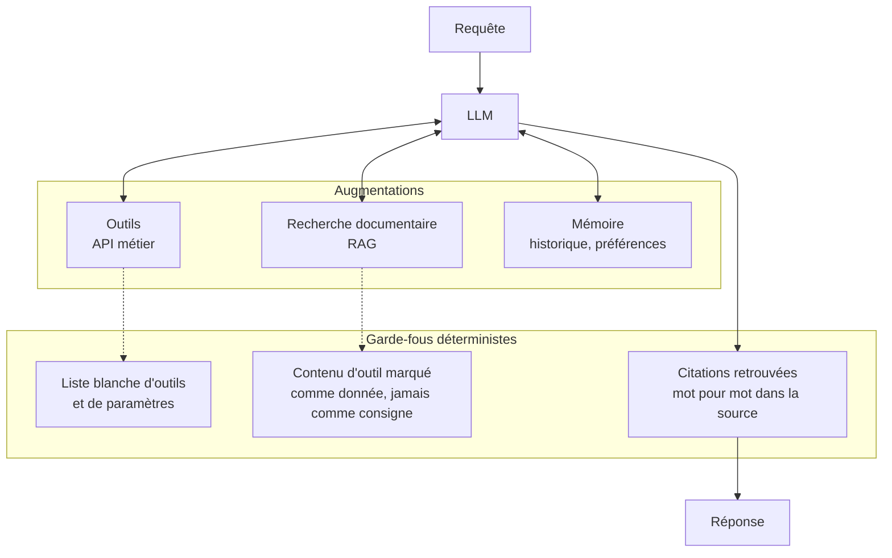

# 03 — LLM augmenté (recherche, outils, mémoire)

La brique de base : un appel LLM qui peut chercher dans une base, appeler des outils et lire une mémoire. Avant de construire plus compliqué, il faut que cette brique soit solide.

**Exemple (illustratif) :** assistant interne qui répond aux questions RH en citant le passage exact de la convention d'entreprise.

## Quand ne PAS l'utiliser
- Quand la réponse exige plusieurs étapes dépendantes avec contrôle entre elles (02).
- Quand les outils exposent des actions irréversibles sans validation humaine.

## Coût et latence
Faible : un appel, plus le coût des récupérations et des outils. Le coût dérive surtout via un contexte trop gros (trop de documents récupérés).

## Pannes typiques et parades

| Panne | Symptôme | Détection | Parade |
|---|---|---|---|
| Injection de prompt via outil ou document | Le modèle suit une consigne cachée dans une page ou un e-mail | Appel d'outil hors liste blanche, action inattendue | Contenu externe délimité comme donnée, outils à privilèges minimaux, actions sensibles validées hors LLM |
| Récupération hors sujet | Réponse fausse mais plausible, sourcée sur le mauvais document | Citation absente de la source | Vérification que chaque citation existe mot pour mot, sinon « je ne sais pas » |
| Mémoire polluée | Une erreur ancienne est réutilisée | Revue des écritures mémoire | Écriture mémoire explicite et révocable, pas automatique |
| Contexte gonflé | Coût et latence qui montent | Tokens par requête | Plafond de documents et de tokens |

## Contrôles déterministes plutôt qu'un LLM juge
Liste blanche d'outils et validation des paramètres, correspondance exacte des citations, plafond de tokens. C'est du code, pas du jugement.

## Évaluation
Jeu de questions figé avec documents attendus et réponse de référence. Métriques : rappel de la récupération (le bon document est-il dans le contexte ?), taux de citations vérifiées, taux de « je ne sais pas » justifié. Ajouter des cas d'injection connus au jeu.
