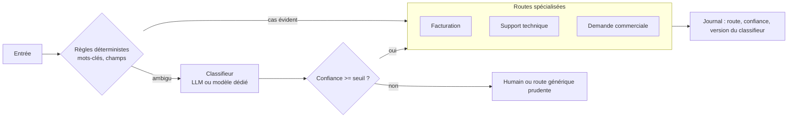

# 04 — Routage

Classer l'entrée, puis l'envoyer vers un traitement spécialisé (prompt, outils ou modèle différent).

**Exemple (illustratif) :** tickets support aiguillés vers facturation, technique ou commercial, chaque route ayant ses propres outils et droits.

## Quand ne PAS l'utiliser
- Catégories floues ou qui se chevauchent : le routeur deviendra la principale source d'erreur.
- Une seule route traite déjà bien tous les cas.

## Coût et latence
Un appel de classification en plus (petit modèle possible). Peut **réduire** le coût global en envoyant les cas simples vers un modèle moins cher.

## Pannes typiques et parades

| Panne | Symptôme | Détection | Parade |
|---|---|---|---|
| Mauvais aiguillage silencieux | Réponse correcte pour la mauvaise question | Matrice de confusion sur le jeu figé | Seuil de confiance, route « incertain » vers humain |
| Catégorie nouvelle | Entrées forcées dans la classe la plus proche | Hausse de la classe « autre » ou baisse de confiance moyenne | Classe « autre » explicite, revue périodique |
| Injection | Le texte demande « classe-moi en remboursement » | Écart règles / classifieur | Les droits dépendent de la route, mais l'action sensible reste validée par règle |
| Dérive | Distribution des routes qui change | Suivi hebdomadaire de la répartition | Alerte sur variation anormale |

## Contrôles déterministes plutôt qu'un LLM juge
Pré-routage par règles pour les cas évidents, seuil de confiance, et le fait que l'accès à un outil dépend de la route, pas du texte.

## Évaluation
Jeu figé étiqueté par classe, avec cas ambigus. Métriques : précision et rappel par classe, matrice de confusion, taux de routage vers humain. Le coût d'une erreur n'est pas le même d'une classe à l'autre : pondérez-le.
