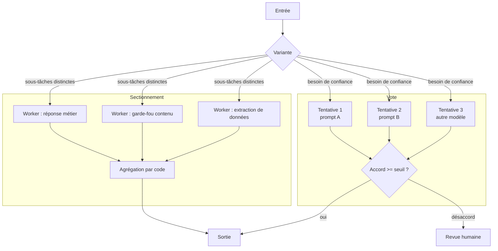

# 05 — Parallélisation : sectionnement et vote

Deux variantes. **Sectionnement** : des sous-tâches indépendantes connues à l'avance, en parallèle. **Vote** : la même tâche plusieurs fois, puis agrégation.

**Exemple (illustratif) :** revue de code où trois prompts différents cherchent chacun une classe de vulnérabilité ; tout signalement par au moins un prompt est remonté.

## Quand ne PAS l'utiliser
- Sous-tâches dépendantes les unes des autres : c'est du chaînage (02).
- Vote avec N fois le même modèle et le même prompt : erreurs corrélées, fausse confiance.

## Coût et latence
Coût multiplié par le nombre de branches. Latence proche de la branche la plus lente, donc plus faible qu'en séquentiel.

## Pannes typiques et parades

| Panne | Symptôme | Détection | Parade |
|---|---|---|---|
| Vote corrélé | Unanimité sur une réponse fausse | Accord élevé mais erreur sur le jeu figé | Diversifier prompts, modèles ou sources ; mesurer le gain réel du vote |
| Branche en échec | Une branche timeout, l'agrégation continue sans elle | Compteur de branches reçues | Agrégation qui exige toutes les branches ou marque le résultat partiel |
| Conflit entre sections | Deux sections se contredisent | Contrôle de cohérence par code | Règle de priorité explicite, sinon revue |
| Coût multiplié | Facture qui suit N x volume | Coût par tâche | Vote réservé aux cas à fort enjeu, pré-filtre bon marché |

## Contrôles déterministes plutôt qu'un LLM juge
L'agrégation se fait par code : majorité, unanimité, union des signalements, seuils. Un LLM agrégateur réintroduit un point unique de panne.

## Évaluation
Comparer sur le même jeu figé : une branche seule contre le vote. Si le vote n'améliore pas la métrique au-delà du bruit, il ne fait que coûter. Mesurer le taux de désaccord, qui est un bon signal d'incertitude.
