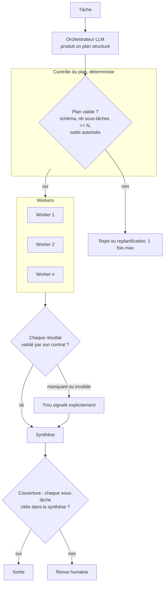

# 06 — Orchestrateur-workers

Un LLM central décide **à l'exécution** quelles sous-tâches lancer, les délègue à des workers, puis synthétise. Différence avec la parallélisation : les sous-tâches ne sont pas connues d'avance.

**Exemple (illustratif) :** une modification de code qui touche un nombre de fichiers inconnu d'avance ; l'orchestrateur liste les fichiers, un worker par fichier, puis la suite de tests tranche.

## Quand ne PAS l'utiliser
- Si les sous-tâches sont toujours les mêmes : sectionnement (05), moins cher et testable.
- Si aucune vérification de la synthèse n'est possible : vous empilez de l'incertitude.

## Coût et latence
Élevés : un appel de planification, N workers, une synthèse. Le coût varie avec le plan, donc il faut le borner.

## Pannes typiques et parades

| Panne | Symptôme | Détection | Parade |
|---|---|---|---|
| Plan incomplet | Une partie du problème jamais traitée | Couverture du plan contre une liste de contrôle | Checklist déterministe des aspects obligatoires |
| Explosion du plan | 40 sous-tâches pour une demande simple | Nb de sous-tâches > N | Plafond dur, rejet du plan |
| Synthèse qui masque les trous | Texte fluide qui omet un worker en échec | Chaque sous-tâche doit apparaître dans la synthèse | Trous marqués explicitement, jamais lissés |
| Erreur en cascade | Un worker faux contamine la synthèse | Contrat de sortie par worker | Validation par worker avant synthèse |
| Injection via un worker | Un document lu par un worker donne des ordres à l'orchestrateur | Sortie de worker contenant des instructions | Sorties de workers traitées comme données, schéma strict |

## Contrôles déterministes plutôt qu'un LLM juge
Validation du plan (schéma, plafond, outils), contrat de sortie par worker, vérification de couverture, tests automatiques quand ils existent (code).

## Évaluation
Jeu figé de tâches avec, pour chacune, la liste des sous-tâches attendues. Métriques : couverture du plan, taux de réussite final, coût et nombre de sous-tâches par tâche (distribution, pas moyenne seule).
