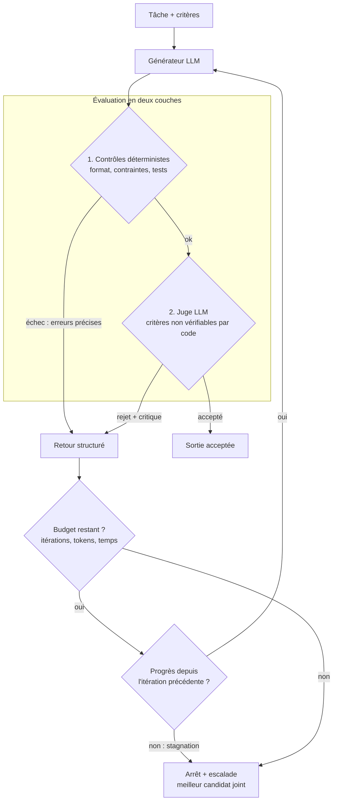

# 07 — Évaluateur-optimiseur

Un générateur propose, un évaluateur critique, on boucle jusqu'à acceptation **ou budget épuisé**. Implémentation exécutable : [examples/evaluateur_optimiseur.py](../examples/evaluateur_optimiseur.py).

**Exemple (illustratif) :** rédaction d'un résumé de contrat qui doit contenir toutes les dates et montants de la source et tenir en 150 mots ; le code vérifie dates, montants et longueur, le juge LLM la clarté.

## Quand ne PAS l'utiliser
- Pas de critère clair : la boucle tourne sans converger.
- Le générateur réussit déjà au premier coup sur le jeu figé : la boucle n'ajoute que du coût.
- Le juge ne fait pas mieux que le générateur pour détecter l'erreur.

## Coût et latence
Multipliés par le nombre d'itérations, variables d'une tâche à l'autre. Le budget maximal fixe le pire cas.

## Pannes typiques et parades

| Panne | Symptôme | Détection | Parade |
|---|---|---|---|
| Boucle infinie | Aucune acceptation | Compteur d'itérations | Budget dur d'itérations, de tokens et de temps |
| Oscillation | Corrige A, casse B, corrige B, casse A | Même signature d'erreurs qui revient | Détection de stagnation, arrêt |
| Juge complaisant | Accepte une sortie fausse mais plausible | Erreurs silencieuses sur le jeu figé | Contrôles déterministes **avant** le juge, juge différent du générateur |
| Juge trop sévère | Rejets sans fin | Taux d'escalade élevé | Calibrer le juge sur des exemples étiquetés |
| Sur-optimisation | La sortie satisfait le juge, pas l'utilisateur | Écart juge / humain sur échantillon | Revue humaine par échantillonnage |

## Contrôles déterministes plutôt qu'un LLM juge
Tout ce qui se vérifie par code passe en premier : format, longueur, présence des valeurs de la source, tests. Le juge LLM ne voit que les candidats déjà valides. Le retour au générateur est structuré (liste d'erreurs précises), pas une impression.

## Évaluation
Jeu figé avec sorties de référence. Comparer : une seule génération contre boucle. Métriques : taux d'acceptation, itérations moyennes et maximales, taux d'escalade, erreurs silencieuses (accepté mais faux). L'exemple du dépôt calcule ces métriques sur un jeu synthétique.
