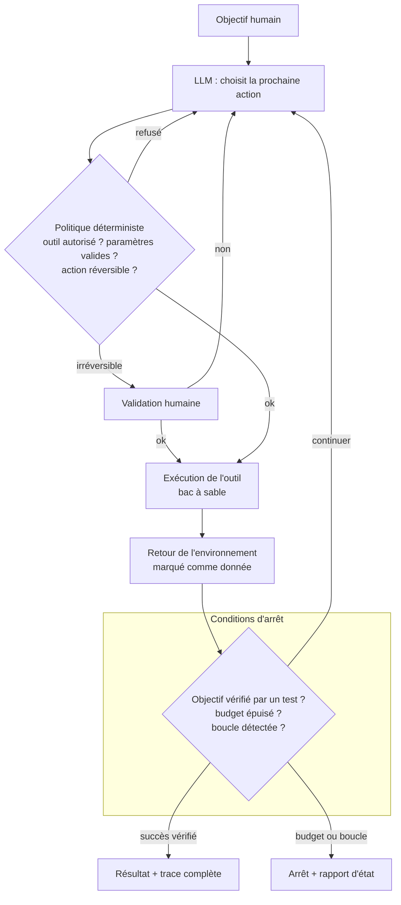

# 08 — Agent autonome

Un LLM qui choisit lui-même ses actions en boucle, à partir du retour de l'environnement, jusqu'à la fin de la tâche ou une condition d'arrêt.

**Exemple (illustratif) :** un agent de code qui corrige un bug signalé, lance la suite de tests après chaque modification et s'arrête quand elle passe ou après N tentatives.

## Quand ne PAS l'utiliser
- Le chemin peut être codé à l'avance : un workflow (01 à 07) sera moins cher, plus prévisible, testable.
- Pas de signal fiable de l'environnement (pas de tests, pas de vérité terrain) : l'agent ne sait pas s'il progresse.
- Actions irréversibles (paiement, suppression, envoi) sans validation humaine.

## Coût et latence
Élevés et **variables** : le nombre de tours n'est pas connu d'avance. Sans plafond, le pire cas n'est pas borné.

## Pannes typiques et parades

| Panne | Symptôme | Détection | Parade |
|---|---|---|---|
| Boucle | Même action répétée | Empreinte des dernières actions | Détecteur de répétition + plafond de tours |
| Dérive des coûts | Tâches qui coûtent 10x la médiane | Coût par tâche en temps réel | Budget dur par tâche, arrêt avec rapport |
| Erreurs en cascade | Hypothèse fausse au tour 2, tout le reste bâti dessus | Vérification après chaque action | Ancrer chaque étape sur un retour réel (test, lecture), pas sur la mémoire du modèle |
| Injection via outil | Page web ou fichier qui donne des ordres | Action hors objectif | Contenu externe = donnée, privilèges minimaux, actions sensibles validées hors LLM |
| Faux succès | L'agent déclare fini sans l'être | Succès non vérifié | Condition de succès vérifiée par code, jamais par auto-déclaration |
| Action irréversible | Suppression ou envoi non voulu | Journal d'actions | Bac à sable, liste blanche, validation humaine |

## Contrôles déterministes plutôt qu'un LLM juge
Politique d'outils (liste blanche, validation de paramètres, classement réversible/irréversible), budget, détection de boucle, et surtout un **critère de succès exécutable** (tests, requête de vérification).

## Évaluation
Jeu figé de tâches dans un environnement reproductible (bac à sable réinitialisé). Métriques : taux de succès vérifié, coût et nombre de tours (distribution complète, percentiles hauts compris), taux d'actions refusées par la politique, taux d'arrêt sur budget. Rejouer plusieurs fois chaque tâche : un agent est non déterministe.
