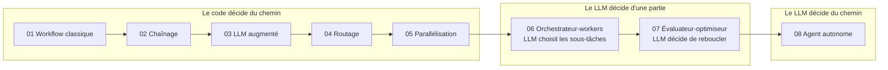

# 09 — La frontière workflow / agent

La distinction qui structure tout le reste : dans un **workflow**, le code décide du chemin et le LLM remplit des étapes. Dans un **agent**, le LLM décide du chemin. Cette frontière se déplace étape par étape, ce n'est pas un interrupteur.

## Test avant de passer à droite de la frontière

Répondez à chaque question. Un seul « non » : restez en workflow.

| Question | Si non |
|---|---|
| Ai-je écrit les étapes à la main et constaté que le chemin varie vraiment selon l'entrée ? | Workflow codé |
| Existe-t-il un signal de l'environnement qui dit si l'agent progresse (tests, état vérifiable) ? | L'agent ne peut pas se corriger |
| Les actions sont-elles réversibles, ou les irréversibles validées par un humain ? | Risque inacceptable |
| Ai-je un budget dur (tours, tokens, temps) et une condition d'arrêt ? | Coût non borné |
| Ai-je un jeu d'évaluation où le workflow le plus simple échoue et l'agent réussit ? | La complexité n'est pas justifiée |

## Ce que l'autonomie coûte
- **Prévisibilité** : deux exécutions de la même tâche peuvent suivre deux chemins.
- **Testabilité** : on teste des distributions de résultats, pas un résultat.
- **Débogage** : il faut la trace complète des décisions pour comprendre une panne.

## Erreur fréquente
Construire un agent pour un processus en réalité fixe, parce que « agent » sonne mieux. Le résultat est plus cher, plus lent et moins fiable que le workflow équivalent.
